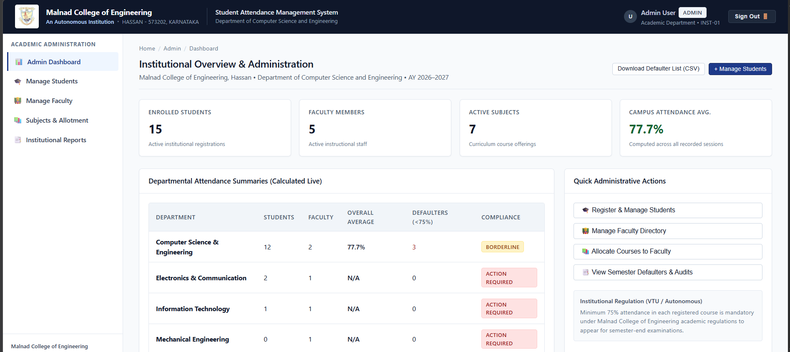
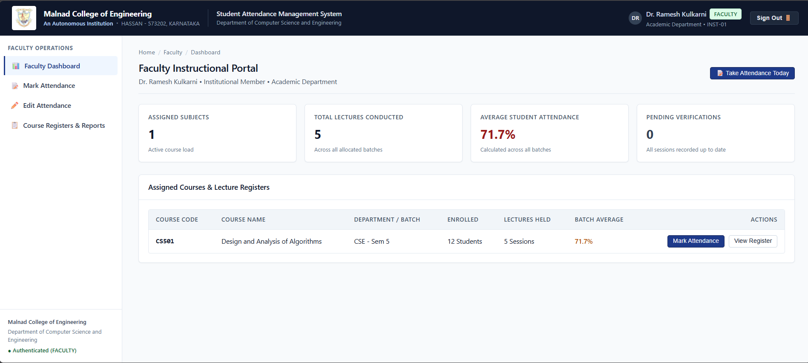
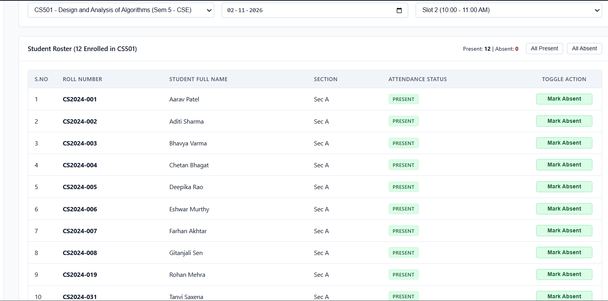
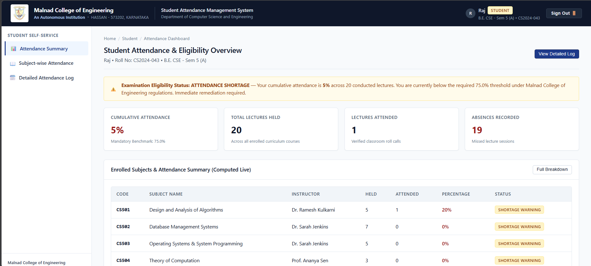
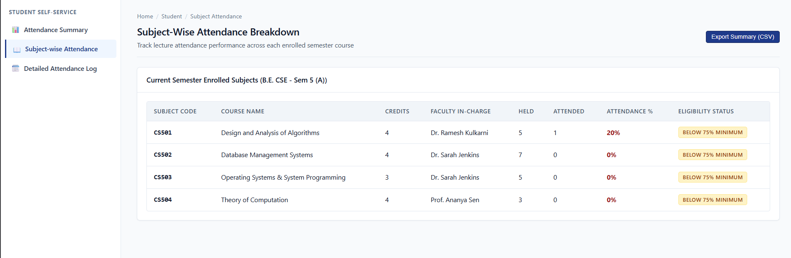

# Student Attendance Management System (SAMS)

### Malnad College of Engineering, Hassan
**Department of Computer Science and Engineering**

A practical institutional web application for managing, monitoring, and auditing student attendance with role-based access for **Administrators, Faculty, and Students**.

Developed as a **Cloud Computing** project using **React + Vite** and Firebase services, with a service-layer architecture for authentication, attendance management, and role-based access.

---

## 📸 Application Screenshots

### Admin Dashboard


### Faculty Dashboard


### Mark Attendance


### Student Dashboard


### Attendance History

---

## 🏛️ System Features

### 1. Administration
- Student directory and enrollment management
- Add, update, and manage student records
- Faculty directory management
- Subject and curriculum management
- Assign subjects to faculty
- Institutional attendance and defaulter reports
- Attendance percentage calculations
- CSV report export
- Campus-wide attendance metrics

### 2. Faculty
- Faculty dashboard
- View assigned subjects
- Mark student attendance
- Present/Absent batch actions
- Duplicate attendance-session prevention
- Edit historical attendance
- Course attendance registers
- Student-wise attendance percentages
- Attendance compliance status

### 3. Student
- Personal attendance dashboard
- Overall attendance percentage
- Classes held vs. classes attended
- Subject-wise attendance
- Assigned faculty information
- Attendance history
- Detailed chronological attendance log
- Examination eligibility status

---

## ☁️ Cloud Architecture

The application uses Firebase services for its cloud-oriented architecture.

```text
                    Internet
                       |
                       v
              +-------------------+
              |  Firebase Hosting |
              |   React Frontend  |
              +---------+---------+
                        |
                        v
              +-------------------+
              | Firebase Services |
              +---------+---------+
                        |
          +-------------+-------------+
          |             |             |
          v             v             v
   Authentication   Cloud Firestore   Security Rules
          |             |             |
          v             v             v
       User Login   Attendance Data   Role-based
                    Student Data      Access Control
                    Faculty Data
                    Subject Data
```

### Architecture Diagram


---

## 🎨 UI/UX Design

The interface follows an institutional academic ERP style, with an emphasis on clarity, consistency, and accessibility.

- Restrained navy (`#0f172a`, `#1e3a8a`) and neutral slate (`#f8fafc`) color palette
- Tabular number rendering for aligned statistics and percentages
- High-contrast status indicators for Present, Absent, and Shortage
- Responsive layouts and straightforward navigation
- Minimal animation and visual decoration

---

## 🔐 Authentication and Role-Based Access

The application includes:

- Firebase Authentication integration
- Role-based route protection using `ProtectedRoute`
- Separate Admin, Faculty, and Student application areas
- Authentication service with local session fallback for supported development scenarios

Demo accounts can be configured for project evaluation. **Do not publish real passwords, private credentials, or production account details in this repository.** Use disposable test accounts and share evaluator-only credentials through an appropriate private channel.

---

## 📁 Project Structure

```text
student-attendance-management-system/
├── public/
├── screenshots/
│   ├── admin-dashboard.png
│   ├── attendance-history.png
│   ├── faculty-dashboard.png
│   ├── mark-attendance.png
│   └── student-dashboard.png
├── src/
│   ├── components/
│   │   ├── common/             # Shared UI components and route protection
│   │   └── layout/             # Header, sidebar, and application layout
│   ├── context/                # Authentication and role context
│   ├── data/                   # Seed data
│   ├── firebase/               # Firebase configuration and seeding utility
│   ├── pages/
│   │   ├── admin/              # Admin dashboard and management pages
│   │   ├── faculty/            # Faculty dashboard and attendance workflows
│   │   ├── student/            # Student dashboard and attendance views
│   │   └── auth/               # Login page
│   ├── services/               # Authentication, student, subject, and attendance services
│   ├── App.jsx                 # Route definitions
│   ├── index.css               # Global design system
│   └── main.jsx
├── firestore.rules             # Firestore security rules
├── .env.example                # Environment variable template
├── .firebaserc                 # Default Firebase project configuration
├── firebase.json               # Firebase Hosting configuration
├── package.json
└── vite.config.js
```

---

## 🛠️ Technology Stack

| Area | Technology |
|---|---|
| Frontend | React |
| Build tool | Vite |
| Language | JavaScript |
| Authentication | Firebase Authentication |
| Database | Cloud Firestore |
| Access control | Firestore Security Rules |
| Hosting | Firebase Hosting |
| Package manager | npm |

---

## 🚀 Getting Started

### Prerequisites

- [Node.js](https://nodejs.org/) (v18 or higher)
- npm (v9 or higher)

### Installation

```bash
# Clone the repository
git clone https://github.com/Ankith-Achar-27/student-attendance-management-system.git

# Enter the project directory
cd student-attendance-management-system

# Install dependencies
npm install
```

### Environment Configuration

To connect the application to your Firebase project:

1. Copy `.env.example` to `.env`.
2. Set the required `VITE_FIREBASE_*` environment variables using your Firebase project configuration.
3. Restart the development server after changing environment variables.

Never commit your `.env` file or private service-account credentials. The `.env.example` file should contain variable names and safe placeholders only.

### Run Locally

```bash
npm run dev
```

Open the local URL printed by Vite in your browser (typically `http://localhost:5173/`).

### Lint and Production Build

```bash
npm run lint
npm run build
npm run preview
```

---

## ☁️ Firebase Deployment

The repository includes Firebase configuration for Hosting.

After configuring your Firebase project and building the frontend, deploy the Hosting target using:

```bash
npm run build
firebase deploy --only hosting
```

Firebase Hosting serves the production build from the `dist` directory.

Cloud Functions, if configured, have separate deployment and billing requirements.

---

## 🎓 Project Context

Developed as a Cloud Computing academic project for the **Department of Computer Science and Engineering, Malnad College of Engineering, Hassan**.